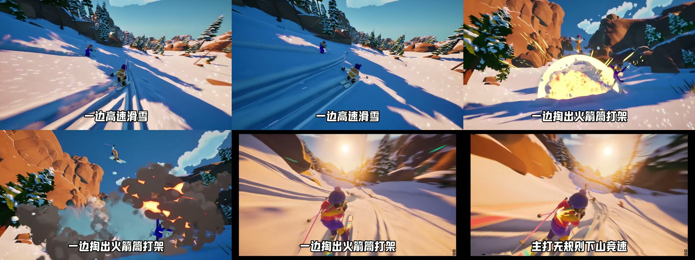
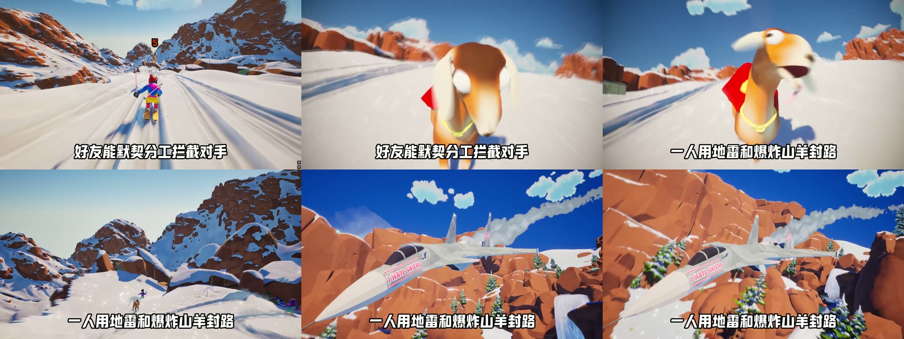
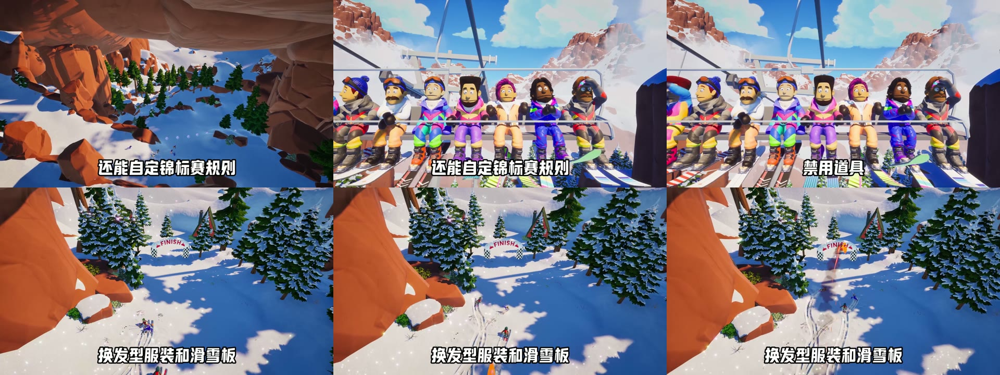
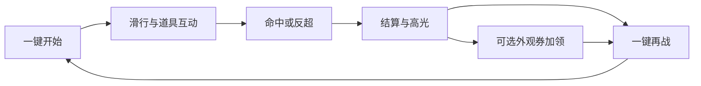
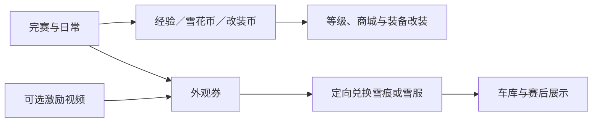
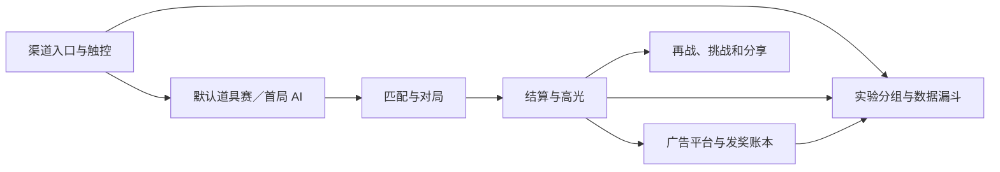

# 《雪山大乱斗》IAA 商业化差距报告

2026 年 11 月 24 日 · 制作人评估 · 以当前工作区源码为准

## 执行摘要

**已有可玩的轻竞技原型。下一站是一个有留存对照组、能测真实广告收入的移动端小流量版本。** 现有内容已足够做第一轮验证。优先补「新手短局 → 击飞或反超 → 一键再战 → 可选广告 → 确定性外观奖励」，然后验证第二局、次日回流和广告净收入。赛季通行证、大量新赛道和重社交系统可以在这条链路成立后再决定。

## 一、游戏基础信息

| 项目 | 已核实的现状 |
| --- | --- |
| 产品 | 《雪山大乱斗》，核心体验是一边高速滑雪，一边用道具干扰对手、争先冲线。 |
| 客户端 | Three.js + Vite 的 H5 工程，已有触控和横屏处理。 |
| 联机 | Node.js、WebSocket 匹配、自定义房、机器人补位、重连及账号存档。 |
| 内容 | 12 条固定赛道、4 个杯赛组、7 种竞赛规则、30 秒试滑、回放和个人计时幽灵。 |
| 商业化 | 有虚拟货币商城和补给箱。当前工作区未找到广告、产品数据漏斗、微信或抖音小游戏的接入和打包入口。 |

证据范围覆盖源码、已有自动化测试与竞品公开资料。当前没有目标渠道、线上留存、买量或广告结算数据。测试以单进程方式运行，40 项通过。Vite 新构建在当前环境启动 esbuild 时遇到 `spawn EPERM`，未验证新构建的运行表现、移动真机或广告链路。

## 二、产品定位与竞品借鉴

定位建议是「**一句话就懂的短局滑雪派对**」。玩家第一眼看懂冲线，第一局体验道具改变排名，玩熟后还能通过走线、漂移和近道赢过别人。

| 参考对象 | 公开资料能确认什么 | 对本项目的启发 |
| --- | --- | --- |
| 《香肠派对》 | 开发方将其定位为卡通射击派对。公开更新展示了有辨识度的道具、主题赛季和预组队等能力。商店标有 App 内购买。 | 把道具命中做成一眼看懂的笑点。先选少量轮廓鲜明、音效和受击反馈明确的道具，例如滚雪球、弹飞、护盾反制。已有回放可做成结算分享卡。 |
| 《球球大作战》 | 开发方公开页用「大球吃小球」说明目标。更新资料展示了团战、好友邀请、孢子和光环，商店也有内购。巨人网络年报披露了小游戏与 App 的双端运营。 | 首页主入口只突出道具赛。局内排名、击飞、反超反馈即时可读。把可见的雪痕和板面作为装扮追求，把房间邀请缩短成可直达的一条链接。 |
| 《Snow Panic》 | Steam 官方介绍了最多 8 人、下坡竞速以及火箭、空袭和爆炸山羊等组合。 | 它与工作区参考素材和部分现有道具设计高度相似。商业版本需要建立独立的美术、角色、道具表现和赛道记忆点。一个可试的原创方向是把现有技巧链接到最后一弯的线路选择，走外道保排名，走内道靠连续漂移攒冲刺翻盘。素材授权状态待核。 |

两款国内产品可以提供竞技、社交和装扮设计参考。公开资料无法推导它们的广告收入结构，也无法当作本项目 IAA 的收入基准。[香肠派对官方 TapTap](https://www.taptap.cn/app/58881) · [香肠派对 App Store](https://apps.apple.com/cn/app/id1326730621) · [球球大作战官方 TapTap](https://www.taptap.cn/app/6239) · [球球大作战 App Store](https://apps.apple.com/cn/app/id996509117) · [巨人网络 2025 年年报](https://static.cninfo.com.cn/finalpage/2026-04-27/1225190389.PDF) · [Snow Panic 官方 Steam 页面](https://store.steampowered.com/app/4572060/Snow_Panic/)

附图 1 · 参考片段展示「先看懂谁在追谁，再看懂道具如何反转」，图源为工作区参考素材。

附图 2 · 山羊和雪道追逐的组合适合用于比对内容辨识度及原创化工作量，图源为工作区参考素材。

附图 3 · 缆车群像可用来分析多人角色识别。三张附图均为参考片段，当前游戏的已实现功能以源码证据为准。

## 三、核心玩法循环

现有循环是「大厅选模式 → 本地开局或排队 → 滑行、走线、打道具 → 结算奖励和高光 → 再战」。缺口主要集中在两端。前端已有游客入口和独立试滑，仍需一条能从冷启动尽快送到首个爽点的路径。后端已有再来一局和回放，仍需让失利玩家看见自己的表现、清楚下一把要做什么，并能把高光发给朋友。

首轮实验只做一个默认入口「开始滑」。复用雪松村剪一条短路线，首局用明显标识的机器人陪练，将转向、拾取、释放道具放到场景中教，先保证出现一次清楚的命中或反超机会。首局时长建议先试 45–75 秒，普通局先试 60–120 秒，最终按完赛和再战数据定。

## 四、系统结构与缺口

| 优先级 | 已有基础 | 还需要的验收内容 |
| --- | --- | --- |
| P0 首局 | 游客、试滑、道具赛、触控 | 从渠道落地一键开始，开局过程可测，手感和镜头适配手机。统计首个道具、首个命中、完赛、结算后再战。 |
| P0 对局体验 | 赛道、排队、AI 补位、房间及重连 | 首发集中一个公开队列，展示真人／AI 组成。验证低并发、组队等待、切后台、弱网、断线续局以及局终发奖。 |
| P0 广告与经济 | 结算、商城、存档和服务端账本 | 确定性外观券、一个主动激励点、日限额、开关和停投能力。验证无填充、提前取消、重复回调、切前后台和结算补偿。 |
| P0 渠道与数据 | H5、触控与浏览器存储 | 定一条分发渠道，测首屏到可玩、真机性能、广告及生命周期。补实验分组、归因、崩溃和线上收入对账。 |
| P1 回访与传播 | 每日任务、周榜、排位、房间链接、回放 | 首周给一件看得见的奖励。先做固定雪道挑战或高光挑战卡，验证分享后能回到同一挑战或房间。 |
| P2 内容运营 | 杯赛、固定／随机赛道及多模式 | 用户回来以后，再扩主题外观、变体道具、轮换活动和组队关系。少量稳定模板先跑出内容产能。 |

## 五、成长结构

账号已经有等级、称号、赛道解锁、装备、改装和装扮。排位已有装备属性归一及禁用改装效果，仍保留不同装备的属性分布。首测建议沿用等级和玩法解锁，把广告收益放在纯展示层。首批只需一套有鲜明剪影的雪服、一条容易被别人看到的雪痕、一组结算动作。车库可预览，比赛与结算能展示，常规完赛也能拿到。

## 六、资源与数值结构

现有比赛与日常产出经验、雪花币和改装币。经验承担等级、赛道与部分装备解锁。雪花币进入装备、商城和补给箱，改装币进入属性改装。直接倍增整场雪花币或改装币会放大影响竞技的成长渠道。优先增加少量专用外观券，以固定兑换为主，广告与正常完赛共用同一件可预览外观目标。

初始实验可设每次激励发可预览的固定券量，每日最多两个激励机会。免费完成几场后也能达成第一件外观。用兑换漏斗与实际赛局分布来调车距、奖励与频率，避免为了看广告故意缩短赛局或刷结算。

## 七、游戏节奏

| 时段 | 玩家体验 | 验证重点 |
| --- | --- | --- |
| 首会话 | 一键开滑，首局做出一次动作，输赢都能立即再战。 | 首个可操作时点、首个爽点、完赛、第二局启动。首局免广告。 |
| 第 2–7 天 | 追第一件外观、挑战今日固定雪道或完成一个明显与玩法相关的任务。 | 次日回访、首周游玩天数、首件外观兑换。 |
| 稳定回流后 | 每周一项变体事件，公开队列保持集中，朋友通过分享进入同一挑战。 | 真人人数、邀请入局、匹配等待、排位真实性、内容生产成本。 |

## 八、IAA 商业化逻辑

| 广告机会 | 首测方案 | 边界 |
| --- | --- | --- |
| 结算页 · 外观券加领 | 第一版唯一启用的激励位。第二局及以后完成指定普通对局可主动加领，奖励预先说明，「再来一局」保留主按钮。 | 首局、实时对局、排队和排位流程保持无广告。基础奖励先到账，广告失败仍可直接再战。 |
| 车库 · 外观试穿 | 作为后续对照，可试用一局纯外观，和结算位按人群分开测试。 | 试穿可以放在非排位；使用与观看均不能改变任何模式的道具、属性、排名或进场机会。 |
| 插屏 | 首测关闭。确认留存稳定、明确需要验证增量时，才在自愿返回大厅的自然断点做小样本限频试验。 | 不阻塞好友进房，出现收入增加但留存或再战受损时回滚。 |

发奖须以平台支持的观看完成信号作为前提，由后端按账号、广告位和奖励单去重发放。平台如支持可验证回执则使用，并用广告平台结算对账。记录请求、加载结果、展示、完整观看、发奖和回到游戏。运营端能按渠道、版本和用户分组关停广告，无填充、关闭或切后台都有可继续的路径。 [腾讯广告激励视频组件说明](https://training.tencentads.com/uploads/202111/F41TzsT5_cOhQNj.pdf)

## 九、留存设计

优先做两条回路。当天靠「再试一次我能赢」支撑连开，保留再战主按钮，让败者也看得到个人最佳、反超次数或一段回放。次日靠「同一目标还能继续」拉回，突出第一件可兑换的外观或一天一条的计时挑战。好友关系先验证「一个人分享 → 朋友直接进同房／同挑战 → 一起完赛」，有足够的邀请入局后再加好友列表、固定队和更多社交层。

首周可用现有冰湖环线做「冰湖近道挑战」。复用固定赛道和结算计时展示个人最好成绩，累计正常参与可兑换一条极光雪痕。挑战卡带成绩和直达入口，让朋友一键挑战同一条雪道。

## 十、当前最值得复用的设计

1. **现有道具与技巧链能生成高光。** 首轮素材可以直接围绕走线反超、击飞反转和险胜做三个版本，分别看导入的新玩家是否会完赛和再战。
2. **既有赛道、机器人与回放降低首测成本。** 裁短雪松村、复用 AI 补位，选两条辨识度鲜明的普通赛道。高光先做截图挑战卡，后续再测视频分享成本。
3. **竞技和长期成长已有部分隔离。** 延续排位禁用改装效果的方向，外观奖励不影响名次。把真人对局与机器人陪练标识和数据分开，避免把 AI 体验当作真人对抗的留存。

## 十一、问题与风险

| 风险 | 早期信号 | 应对 |
| --- | --- | --- |
| 手机首局难上手 | 玩家进了赛道却没完成转向、第一次命中太晚、结算前退出。 | 用真机录屏定位输入和镜头问题。改开局路线、控件和对手节奏，关注中低端机 P90。 |
| 匹配与排位公信力 | 真人少导致等太久，房主切换后状态不一致，成绩与客户端上报依赖较多。 | 小流量集中队列，明确 AI 局。正式排位前优先由服务端记录对局和可信结果，验证掉线、异常赛果和重复结算。 |
| 广告透支时长或公平 | 有广告组再战和 D1 下降，或出现刷券、重发、弹窗遮挡。 | 首测只有自愿激励，用无广告对照测净增收入与留存，限频并保留关闭开关。 |
| 小游戏交付和运营 | 工程依赖 DOM、iframe、浏览器存储与 WebGL。H5 短局可以测玩法，小游戏包及广告需在真实运行时验证。 | 若首发微信或抖音，先移植「开场、单局、结算、激励」竖切，验证性能及生命周期，再搬完整大厅。渠道确定后核对审核、资质、隐私与素材授权。 |
| 原创辨识度 | 宣传片和道具容易被对标到《Snow Panic》。 | 以原创角色轮廓、赛道地标和一个独有反超机制做对外素材，并核对图、声、视频及第三方资产来源。 |

线上技术检查优先覆盖首包和资源、触控横屏、画质降级、前后台、重连、幂等奖励、服务监控和回滚。小游戏运行适配参考平台相关技术说明。 [Cocos 微信小游戏发布文档](https://docs.cocos.com/creator/3.6/manual/zh/editor/publish/publish-wechatgame.html) · [腾讯云小游戏运行环境说明](https://cloud.tencent.com/developer/article/1160763)

## 十二、制作人判断与验收顺序

**第一版范围** · 一个主入口、一个短首局、两条普通赛道、一个外观兑换目标、一个广告位、一个无广告对照组。首周挑战用既有计时赛或现有赛道规则，等首局与连开站稳后再开启。

| 验证顺序 | 观察什么 | 如何决定下一步 |
| --- | --- | --- |
| 1. 无广告玩法测试 | 首屏、开局、首命中、首完赛、结算用户第二局启动率、D1。按渠道和设备分层。 | 试玩先看漏斗。如果人进来了却没完赛，先打磨手感与引导。完赛高但再战低，优先改精彩时刻密度和败局反馈。 |
| 2. 激励视频对照 | 按新增账号固定分组。A 无广告，B 在完成第二局后可看到结算激励。比较 D1、D7、每人局数、观看完成、发奖成功和每新增广告净收入。 | 用随机分组总体评估结果，也看双方达到展示条件的人群。收入要覆盖体验损耗，首次实验先确定样本量和可接受的留存变化。 |
| 3. 小额获客与放量 | 对比滑雪速度、道具搞笑、终点反超三类创意，分渠道计算实际 eCPM、用户获取成本及 D7／D30 预测。 | 广告 LTV 用每新增账号累计确认收入估算，按渠道和地区与获客成本比较，并扣入服务器及运营等可变成本。小额数据未稳定前暂缓扩大投入。 |

第一轮内部假设可以用「启动首局的用户完赛率 ≥70%，首局结算后的第二局启动率 ≥50%」做讨论起点。它们是项目试验目标，须以基线、渠道和样本区间调整。广告组允许的 D1 变化、最低净收入和最小可测样本应在实验前定；D1 定义为首开次日回访，D7 类推。

测算时可用「实际展示次数 ÷ 活跃用户数 × eCPM ÷ 1,000」估算每日每活跃用户广告收入。放量判断使用广告平台确认的分组累计净收入除以同组新增人数，并把服务器、运营等可变成本纳入每新增用户的可承受获客成本。

## 十三、循环图

### 核心循环图

### 资源结构图

### 系统架构图

## 资料来源

- 项目现状 · [工程依赖](../package.json) · [主流程](../src/main.js) · [联机匹配](../server/match.js) · [账号](../src/account.js) · [赛道](../src/tracks.js) · [规则](../src/config.js) · [成长经济](../src/profile.js) · [装备商城与公平数值](../src/gear.js) · [结算](../src/ui/results.js) · [邀请](../src/ui/matching.js) · [回放](../src/replay.js) · [H5 入口](../src/boot.js)
- 竞品 · [香肠派对 TapTap](https://www.taptap.cn/app/58881) · [香肠派对 App Store](https://apps.apple.com/cn/app/id1326730621) · [球球大作战 TapTap](https://www.taptap.cn/app/6239) · [球球大作战 App Store](https://apps.apple.com/cn/app/id996509117) · [巨人网络年报](https://static.cninfo.com.cn/finalpage/2026-04-27/1225190389.PDF) · [Snow Panic Steam](https://store.steampowered.com/app/4572060/Snow_Panic/)
- 接入 · [腾讯广告激励式广告组件](https://training.tencentads.com/uploads/202111/F41TzsT5_cOhQNj.pdf) · [Cocos 微信小游戏发布文档](https://docs.cocos.com/creator/3.6/manual/zh/editor/publish/publish-wechatgame.html) · [腾讯云小游戏运行环境说明](https://cloud.tencent.com/developer/article/1160763)
